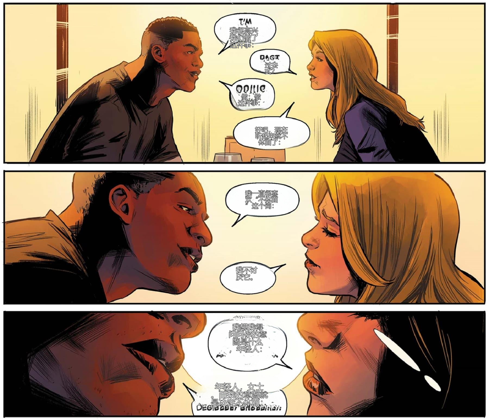
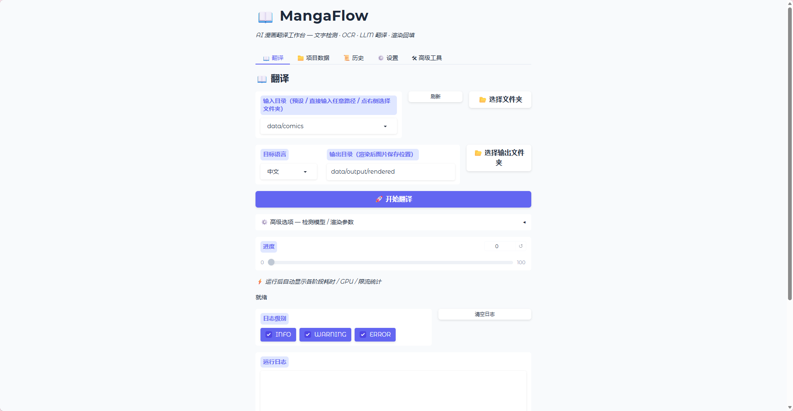

# MangaFlow · 漫画翻译系统


自动化的漫画/漫画图片翻译系统：给定一组漫画图片，自动完成 **文字检测 → OCR 识别 → LLM 翻译 → 原文抹除 → 译文回填渲染** 的全流程，输出翻译后的图片。

- **CLI**：`comic-translator`（typer）—— 初始化项目、批量翻译、断点续跑、项目列表
- **Web GUI**：Gradio（本地 `127.0.0.1:7860`）—— 翻译页、设置页、调试页、实时日志

> 当前定位：**英文漫画 → 中文** 等语言对，强调批量处理、角色一致性与术语一致性。

---

## 🖼️ 效果展示

> 翻译前后对比图与 GUI 界面截图待补充（由维护者提供真实运行截图）。

<!-- TODO: 替换为真实截图
| 原文 | 翻译后 |
|------|--------|
|  |  |


-->

---

## ✨ 功能特性

| 功能 | 说明 |
|------|------|
| 文字区域检测 | CTBD（RT-DETR-v2）检测 `text_bubble` / `text_free` / `bubble` 三类区域 |
| 气泡检测 | YOLO11-seg 实例分割（含掩码/多边形），支持与文字区域融合 |
| OCR 识别 | EasyOCR（默认英文），支持 GPU 加速；另有 PaddleOCR / MangaOCR 扩展点 |
| LLM 翻译 | OpenAI 兼容 API（DeepSeek / 商汤 Sensenova）+ 本地 Ollama 双模式 |
| 渲染回填 | OCR 掩码 + 背景修复（OpenCV / LaMa）+ 字体排版，译文画回图片 |
| 翻译记忆 | 已有译文复用（精确匹配 + LIKE 模糊匹配 + 语义匹配） |
| 角色一致性 | 跨页记住角色称呼与说话风格 |
| 术语表 | 自定义术语词典（增删改查/分类），自动从译文提取专有名词 |
| 批处理 | 整本漫画批量处理，断点续跑（resume） |
| 跨气泡纠错 | 自动识别被 OCR 合并的相邻气泡并拆分二次识别 |

---

## 🚀 快速开始

### 方式一：Web GUI（推荐）

```bash
python -m comic_translator.gui.app          # 默认 http://127.0.0.1:7860
python -m comic_translator.gui.app --port 7860 --share
```

1. 打开浏览器访问 `http://127.0.0.1:7860`
2. 切到 **⚙️ 设置** Tab，在 **API Key** 输入框粘贴你的 key，点 **保存配置**（立即生效，无需重启）
   - 也可用环境变量 `SENSENOVA_API_KEY`（config.yaml 中 `llm.api.api_key: ${SENSENOVA_API_KEY}`）
   - key 保存在本地 `config.yaml`（已加入 `.gitignore`，不会提交）
3. 到 **📖 翻译** Tab，选择图片目录，点击翻译

### 方式二：CLI

```bash
# 1. 初始化项目
comic-translator init my_comic --input data/comics --title "My Comic"

# 2. 批量翻译
comic-translator run --project <project-id>

# 3. 断点续跑 / 查看项目
comic-translator resume <project-id>
comic-translator list-projects
```

（等价于 `python -m comic_translator init ...` / `python -m comic_translator run --project ...`）

---

## 📦 安装

### 完整安装（推荐，含 GUI / OCR / 检测 / GPU / 渲染）

```bash
pip install -e ".[all]"
```

### 按需安装（最小 → 最大）

```bash
pip install -e .                        # 核心：CLI + 服务层 + 存储
pip install -e ".[gui]"                 # + Web GUI（MangaFlow）
pip install -e ".[ocr]"                 # + EasyOCR 英文识别（GPU 加速可选）
pip install -e ".[gui,ocr]"             # GUI + 英文 OCR（最小可用组合）
pip install -e ".[gui,ocr,gpu,yolo,inpaint]"   # 完整翻译管线（推荐）
pip install -e ".[test]"                # + 开发/测试工具（pytest/ruff/mypy）
```

可选 extras：`gui`、`ocr`、`paddle`、`manga-ocr`、`yolo`、`gpu`、`inpaint`、`vision`、`test`、`all`。

> **GPU 注意**：`torch` / `onnxruntime-gpu` 的 CUDA 构建需从对应索引安装（本项目实际运行于 torch 2.6.0+cu124 / CUDA 12.4 / RTX 4060）。

> **本地开发**：项目自带 `.venv310`（Python 3.10 + 全部 GPU 依赖），可直接使用
> ```bash
> .\.venv310\Scripts\python.exe -m comic_translator.gui.app
> ```

**系统要求**：
- Python 3.10+
- 推荐 NVIDIA GPU（RTX 系列）＋ CUDA 12.4；无 GPU 时以 CPU 运行（较慢）

---

## ⚙️ 配置

配置集中在 `config.yaml`（**已被 .gitignore 忽略，不会提交**），模板见 `config.example.yaml`。

```yaml
llm:
  mode: api            # api / ollama
  api:
    api_key: ${SENSENOVA_API_KEY}   # 环境变量占位，或用 GUI 设置页直接填
    base_url: https://token.sensenova.cn/v1
    model: deepseek-v4-flash
ocr:
  lang: en
translation:
  source_lang: en
  target_lang: zh
  style: western_comic   # western_comic / manga / webtoon
```

- **API key**：推荐在 GUI 设置页填写（掩码显示、保存即生效）；也可以用环境变量 `${VAR}` 占位语法。
- **模型路径**：`models/bubble/...`、`models/lama/big-lama`（见下节）。

---

## 🧠 模型

模型文件**不随仓库分发**，需自行准备放入 `models/`：

| 模型 | 路径 | 用途 |
|------|------|------|
| YOLO11-seg 气泡模型 | `models/bubble/yolo11n-seg-mixed-bubble.pt` | 气泡检测 |
| CTBD 文本检测模型 | 通过 onnxruntime-gpu 加载 | 文字区域检测 |
| LaMa 修复模型 | `models/lama/big-lama` | 背景修复（可选，默认 OpenCV） |
| EasyOCR | 首次运行自动下载 | OCR |

> TODO：提供 `download-models` 命令，从 HuggingFace 自动拉取（见 `PLAN.md`）。

---

## 📁 目录结构

```
src/comic_translator/
├── providers/     # 可插拔能力层（文本检测/气泡/OCR/翻译/修复/渲染/QA）
├── services/      # 业务服务层（OCR、翻译记忆、角色记忆、上下文、批处理、渲染…）
├── storage/       # SQLAlchemy 持久化
├── models/        # Pydantic 数据模型
├── config/        # 配置
├── prompts/       # LLM 提示词模板
├── glossary/      # 术语表
├── cache/         # 缓存
├── utils/         # 依赖注入容器等
└── gui/           # Gradio 界面
```

---

## 🧪 开发与测试

```bash
.\.venv310\Scripts\python.exe -m pytest            # 单元测试
.\.venv310\Scripts\python.exe -m pytest tests/...  # 指定目录
```

- 测试数量：75+ 通过（另有部分用例在受限制沙箱/临时目录权限下会报 `tmp_path` 权限错误，属环境限制非代码问题）。
- 代码规范目标：`ruff` + `mypy`（严格模式）——详见 `pyproject.toml`。

---

## ⚠️ 已知限制

- OCR 目前仅支持**英文**（日文/中文需扩展 OCR provider）
- GPU 依赖通过「借用 torch 自带 CUDA DLL + `os.add_dll_directory`」加载，需与 onnxruntime-gpu 版本匹配；跨平台兼容性有限
- 原生文件夹选择器（`SHBrowseForFolderW`）仅 **Windows** 可用
- **「ML 模型开发」（标注/训练/评估）为进阶功能**：需自备 YOLO 标注数据（labelme 流程见 `scripts/train_bubble_model.py` 文档），数据集目录为本地 `dataset/`（已被 gitignore，不入仓库）
- 部分模块为占位/未实现（`manga_ocr`、`gemma_qa`、`opencv_render` 等），详见 `OPTIMIZATION.md`

---

## 📄 许可

MIT License（见 `LICENSE`）。**注意**：本仓库分发的代码为 MIT，但所用**模型权重各有独立许可**（YOLO/EasyOCR/LaMa 等），商用/再分发前请逐一自查。详见「已知限制」与 `PROJECT_STATUS.md`。

---

## 📚 文档

**用户文档**
- `docs/architecture.md` — 系统架构
- `docs/BUBBLE_ARCHITECTURE.md` — 气泡检测架构
- `docs/OCR_COMPATIBILITY.md` — OCR 兼容性说明
- `docs/BATCH_PIPELINE_DESIGN.md` — 批处理管线设计

**维护者文档**
- `CHANGELOG.md` — 变更日志
- `PLAN.md` — 改进计划与路线图
- `PROJECT_STATUS.md` — 项目现状与已知问题
- `OPTIMIZATION.md` — 优化核查报告
- `RELEASE_CHECKLIST.md` — 发布核对清单
