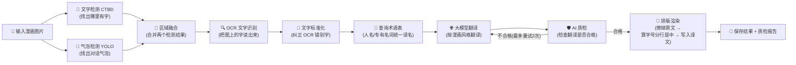

# Comic Translator 项目架构图

> 本项目是一个**漫画翻译系统**:输入一页漫画图片,自动识别文字 → OCR 读取原文 → 用大模型翻译 → 把译文重新画回图里,输出翻译后的漫画。
> 本篇用最通俗的语言 + Mermaid 图,让完全不懂代码的人也能看懂各模块关系。

---

## 1. 一句话看懂

```
用户把漫画图片交给系统
   ↓
系统"看"图找文字 → "读"出原文 → "翻译"成目标语言 → "写"回图片
   ↓
用户拿到翻译好的漫画
```

---

## 2. 系统整体架构图

```mermaid
flowchart TB
    subgraph USER["👤 用户入口"]
        CLI["💻 命令行 (CLI)<br/>python -m comic_translator"]
        GUI["🖥️ Web 界面 (MangaFlow)<br/>翻译流水线 / 调试 / 模型对比<br/>历史任务 / 标注 / 数据集 / 训练 / 设置"]
    end

    subgraph CORE["🧠 核心编排层 (工作流)"]
        WF["LangGraph 翻译工作流<br/>8 个步骤依次执行<br/>见下方「翻译流水线图」"]
        GP["GUI 流水线服务<br/>(逐页处理 + 进度上报)"]
    end

    subgraph SVC["⚙️ 业务服务层 (系统的"大脑")"]
        OCRS["🔍 OCR 服务<br/>文字识别与清洗"]
        TS["🌐 翻译服务<br/>批量翻译 / 术语表 /<br/>翻译记忆 / 角色名一致"]
        QAS["🛡️ 质检服务<br/>AI 检查翻译质量 + 排版质量"]
        RS["🎨 排版渲染服务<br/>字号计算 / 分行 /<br/>居中 / 擦除原文"]
        MEM["🧠 记忆服务<br/>术语表 / 角色身份 / 翻译记忆"]
        PROJ["📁 项目管理服务<br/>创建项目 / 断点续跑"]
    end

    subgraph PROV["🔌 可插拔引擎层 (可换零件的"工具箱")"]
        OCRP["OCR 引擎<br/>PaddleOCR / EasyOCR / MangaOCR"]
        TP["翻译引擎<br/>Qwen / DeepSeek"]
        QAP["质检引擎<br/>Gemma"]
        RP["渲染引擎<br/>OpenCV"]
        BP["气泡检测引擎<br/>YOLO11 分割模型"]
        TDP["文字检测引擎<br/>CTBD 模型"]
        IP["图片修复引擎<br/>LaMa / StableDiffusion / OpenCV"]
        VP["视觉模型<br/>LocateAnything"]
    end

    subgraph LLM["🤖 大模型客户端"]
        OLL["Ollama(本地模型)<br/>qwen3.5 / gemma"]
        OAI["OpenAI 兼容 API<br/>DeepSeek / SenseNova<br/>(云端收费模型)"]
    end

    subgraph DATA["💾 数据与存储层"]
        DB["SQLite 数据库<br/>项目 / 翻译记忆<br/>术语表 / 角色档案"]
        CACHE["文件缓存<br/>OCR / 翻译结果<br/>(避免重复花钱调 API)"]
        CFG["配置文件<br/>config.yaml + defaults.yaml"]
        FONT["字体库 / 模型文件<br/>models/ 目录"]
    end

    subgraph STUFF["🗂️ 辅助部分"]
        DEMO["示例脚本 demo/ + 开发脚本 scripts/"]
        TEST["自动化测试 tests/"]
        DS["数据集 dataset(s)/<br/>用于训练检测模型"]
        DOCS["文档 docs/"]
    end

    CLI --> WF
    GUI --> GP

    WF --> OCRS
    WF --> TS
    WF --> QAS
    WF --> RS
    WF --> MEM
    WF --> PROJ

    GP --> OCRS
    GP --> TS
    GP --> RS
    GP --> QAS

    OCRS --> OCRP
    TS --> TP
    QAS --> QAP
    RS --> RP
    RS --> IP
    OCRS --> TDP
    OCRS --> BP
    TS --> VP

    TP --> OLL
    TP --> OAI
    QAP --> OLL

    MEM --> DB
    PROJ --> DB
    QAS --> DB
    TS --> CACHE
    OCRS --> CACHE
    RS --> CACHE
    RS --> FONT

    CFG --> CORE
    CFG --> SVC
    CFG --> PROV

    GUI --> DEMO
    DS --> BP
    DEMO --> SVC
    TEST --> SVC
```

---

## 3. 翻译流水线图(逐页处理流程)

这是系统最核心的"生产线",从上到下走一遍就是一页漫画的处理过程:



> 📌 **QA 质检的分叉**:翻译完后 AI 会自查一遍,不合格就退回重翻(最多 2 次),避免烂翻译直接渲染进图里。

---

## 4. 各模块通俗对照表

| 层次 | 模块 | 通俗解释(给非程序员) |
|------|------|---------------------|
| 用户入口 | CLI / Web 界面 | 两个"前台柜台":命令行给技术用户,Gradio 网页给所有人 |
| 核心编排 | LangGraph 工作流 | 工厂里的"传送带",规定先做什么、后做什么 |
| 服务层 | OCR 服务 | "打字员",把图片上的字打成文字 |
| 服务层 | 翻译服务 | "翻译官",负责翻成目标语言,还记着术语表和角色名 |
| 服务层 | 质检服务 | "审校员",检查翻译和排版有没有问题 |
| 服务层 | 排版渲染服务 | "美术设计师",算好在气泡里怎么排版、线条怎么分 |
| 服务层 | 记忆服务 | "项目档案室",存术语表、角色档案、翻过的句子 |
| 引擎层 | OCR/翻译/质检/渲染 Provider | "可拆换的零件":想换 OCR 引擎、换翻译大模型,只换零件,不动机器 |
| 客户端 | Ollama / API | "大模型的电话线":本地免费模型或云端付费模型 |
| 数据层 | SQLite / 缓存 / 配置 | "仓库":数据库存长期档案,缓存存临时结果省钱,配置定系统行为 |
| 辅助 | demo / scripts / tests / docs | "车间里的工具架":示例、开发脚本、自动化测试、设计文档 |

---

## 5. 三个关键设计理念

1. **零件可换(Provider 抽象)**:OCR、翻译、质检、渲染等都有统一"接口",比如翻译引擎可以从 Qwen 换成 DeepSeek,只需要改配置,不需要改任何业务代码。
2. **传送带只管运输(Workflow 只编排)**:工作流图只规定步骤顺序,不写业务细节;所有"怎么干活"都在服务层和引擎层。
3. **记忆与缓存省钱(存住结果)**:翻过的句子存进翻译记忆,OCR/翻译结果进文件缓存,同一个页面重复处理时直接复用结果,不重复花钱调 API。